<!-- ═══════════════════════════ HERO ═══════════════════════════ -->

  

  

  

    
    
    
  

<!-- ═══════════════════════════ ABOUT ═══════════════════════════ -->
## ⚡ About Me

<table>
<tr>
<td width="50%" valign="top">
  <ul>
    <li>🎓 <b>Education</b> — Information Systems @ <b>Universitas Amikom Yogyakarta</b></li>
    <li>💻 <b>Focus</b> — Web App Development, UI/UX Prototyping &amp; Interactive Streaming Tools</li>
    <li>🎮 <b>Side Quest</b> — Gaming Content Creator &amp; Live Streamer</li>
    <li>🌱 <b>Currently Learning</b> — Advanced Laravel Architecture &amp; Modern Frontend Workflows</li>
    <li>🤝 <b>Open to</b> — Collabs on web projects, UI/UX, and streaming tools</li>
    <li>📍 <b>Based in</b> — Sleman, Yogyakarta, Indonesia</li>
  </ul>
  <blockquote><i>"Code by day, stream by night."</i> 🌙</blockquote>
</td>
<td width="50%" align="center">
  
</td>
</tr>
</table>

<!-- ═══════════════════════════ TECH STACK ═══════════════════════════ -->
## 🛠️ Tech Stack & Tools

**Frontend & Design**

**Backend & Database**

**Tools & Workflow**

<!-- ═══════════════════════════ STATS ═══════════════════════════ -->
## 📊 GitHub Stats

  
  

  

  

<!-- ═══════════════════════════ SNAKE ═══════════════════════════ -->
## 🐍 Contribution Snake

  <picture>
    <source media="(prefers-color-scheme: dark)" srcset="https://raw.githubusercontent.com/hiwahyuu/hiwahyuu/output/github-snake-dark.svg" />
    <source media="(prefers-color-scheme: light)" srcset="https://raw.githubusercontent.com/hiwahyuu/hiwahyuu/output/github-snake.svg" />
    
  </picture>

<!-- ═══════════════════════════ GAMING ═══════════════════════════ -->
## 🎮 Gaming Corner

  

<!-- ═══════════════════════════ CONNECT ═══════════════════════════ -->
## 🌐 Connect With Me

  
  
  

 

  

